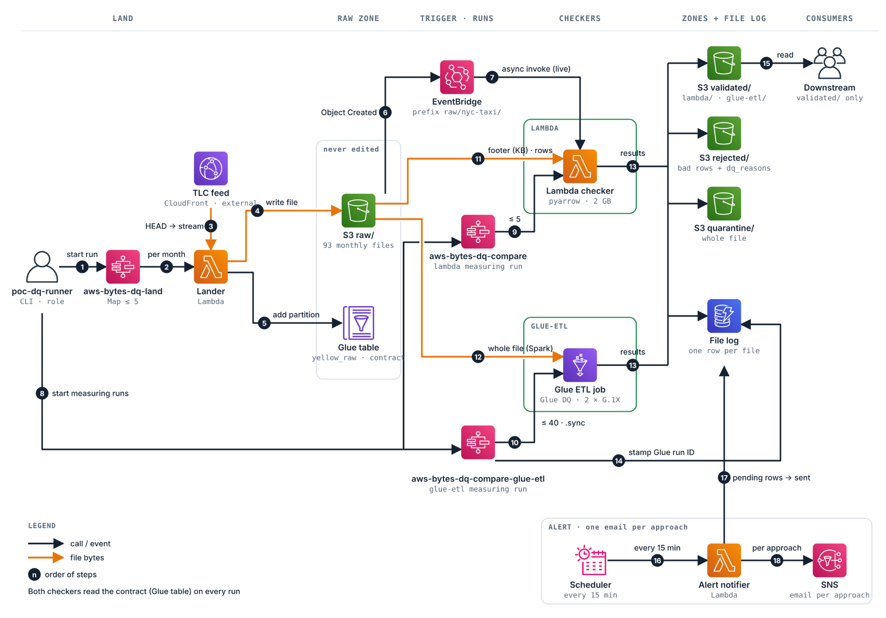
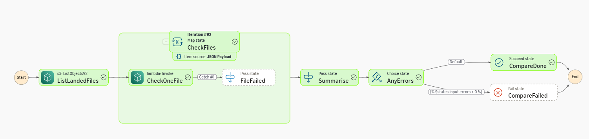
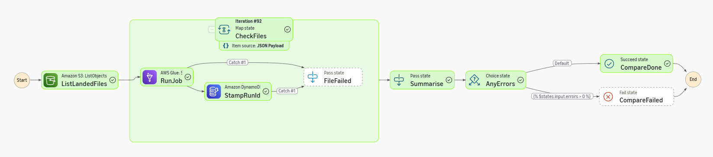
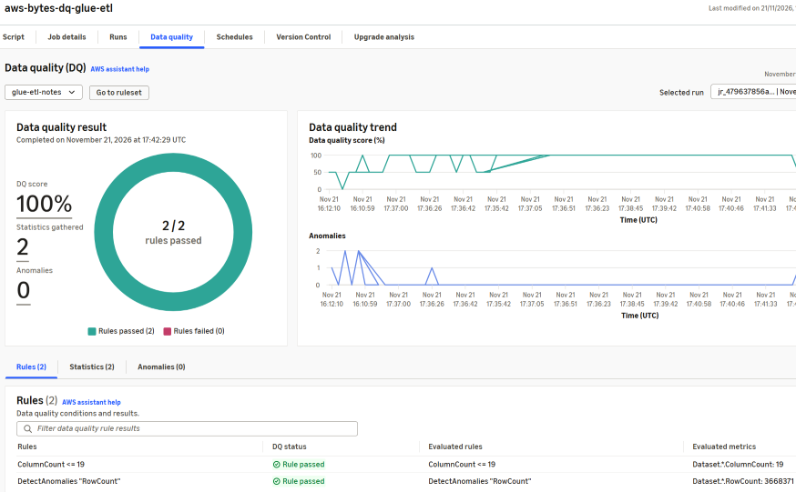
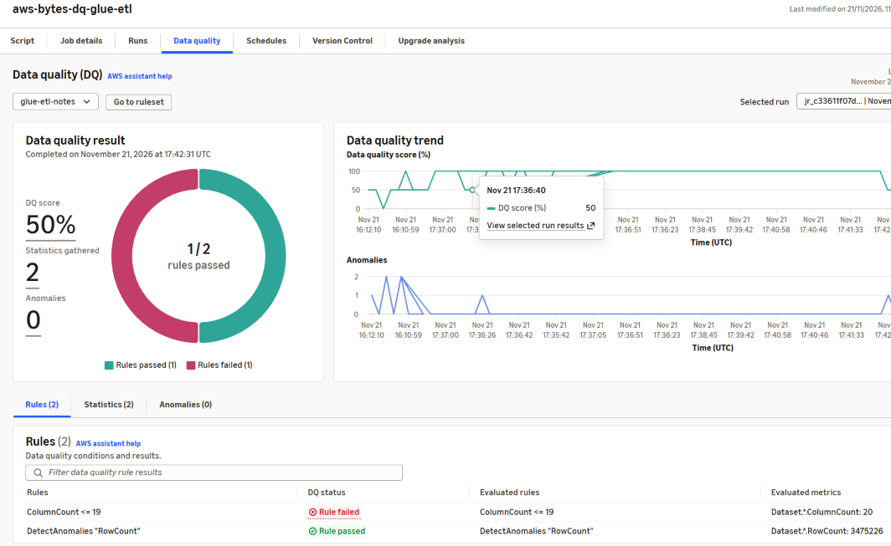
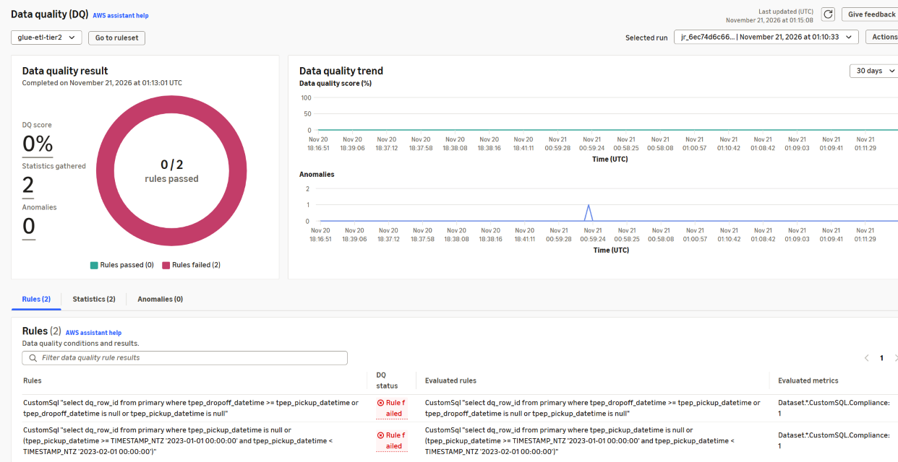
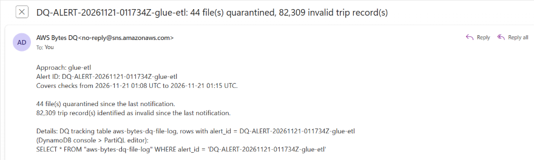
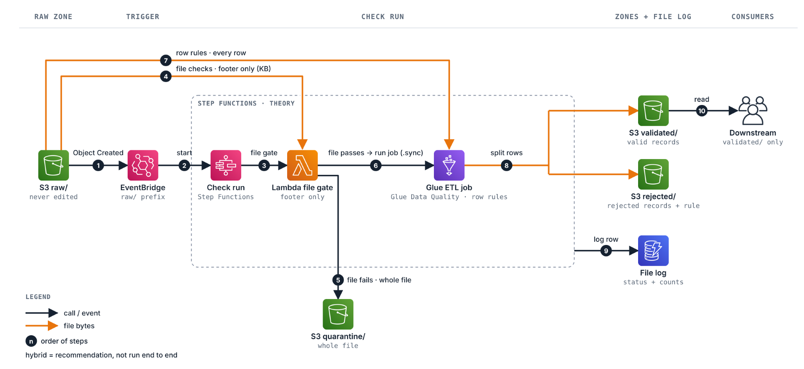

# How do you stop a bad Parquet file at the door of your S3 data lake, before it breaks pipelines or skews your numbers?

A **monthly Parquet file** lands from a source you **don't control**. Before it reaches anyone, two questions need an answer: **can the whole file be trusted**, and **which rows are wrong**? Here both are answered two ways, with a small **Lambda** and with **AWS Glue Data Quality** inside a Glue ETL job, on the same files with the same checks.

**Findings:**
- The feed **changed its own schema** in Feb-2023. Glue Data Quality's `SchemaMatch` rule blocked every file since.
- Lambda and Glue Data Quality gave the **same answer on all 93 files**.
- For files of this size (~60 MB on average), the Lambda was faster and cheaper. **Once files outgrow Lambda's limits (10 GB memory, 15 minutes), Spark-based Glue Data Quality keeps working, and it adds rules as configuration, row-level results and a score history.**

## PoC scenario

| | |
|---|---|
| Source | NYC TLC Yellow trip records: **93 monthly Parquet files, Jan-2019 → Sep-2026, 5.45 GB, 341,589,889 rows** |
| Planted files | Small test files for problems the real feed never had: damaged footer, cut-off copy, zero rows, missing column, column twice, fare as text, size mismatch, same file twice, 14 known bad rows |
| Goal | Check every landed file **before** use: block untrustworthy files, split bad rows from good ones, send an alert, log every result |

## Data quality checks

| Level | Check | Action |
|---|---|---|
| File | File is readable | Quarantine the file |
| File | Size = what the source sent | Quarantine the file |
| File | Same file not delivered twice | Quarantine the file |
| File | File has rows | Quarantine the file |
| File | Every expected column present | Quarantine the file |
| File | No column twice | Quarantine the file |
| File | Column types = expected schema | Quarantine the file |
| File | Column spellings = expected schema | Quarantine the file |
| File | New column | Note only |
| File | Unusual row count | Note only |
| Row | Negative trip duration (dropoff before pickup) | Reject the row |
| Row | Pickup outside the file's month | Reject the row |

Expected schema = the feed's original 2019 schema, kept as a Glue table. Row checks run only on files that passed the file checks.

## Possible options

| # | Approach | How it works | When to use |
|---|---|---|---|
| 1 | **Lambda** | Own Python code; reads the Parquet footer (the file's small summary), then rows in batches | Files up to a few hundred MB, checked as they land. ▶ Try it: deploy this folder's stack |
| 2 | **Glue ETL job + Glue Data Quality** | Checks written as DQDL rules, run by Spark | Large files, CSV/JSON, many datasets, rules as configuration. ▶ Try it: deploy this folder's stack |
| 3 | Glue Data Quality on a **catalog table** | Scores a whole table on a schedule | Health of a curated table, not a gate for one landed file. Not run here |
| 4 | **EMR Serverless** + Amazon EMR Data Quality | Spark on EMR with the same data quality engine as Glue | Teams already running Spark on EMR. Not run here |
| 5 | **Hybrid**: Lambda file gate → Glue Data Quality row rules | Cheap file checks first, Spark only for trusted files | **Recommended** for this kind of feed. See the [hybrid diagram](#recommended-hybrid). Not run end to end |

---

## Architecture



Both approaches read the same `raw/` files and write only to their own folders (`validated/<approach>/`, …) and their own log rows, so both can run at the same time.

---

## Setup (once)

**You need:** an AWS account · an IAM user with admin rights (to deploy) · AWS CLI v2 (your terminal or AWS CloudShell) · this repo cloned · an S3 bucket for deployment files (`<DEPLOY_BUCKET>`).

**1. Package and deploy** with the admin user. Run `package` **from inside `infra/`**:
```bash
cd infra
aws cloudformation package --template-file template.yaml --s3-bucket <DEPLOY_BUCKET> --s3-prefix data-quality-arrival-check --output-template-file packaged.yaml --region ap-south-1
aws cloudformation deploy --template-file packaged.yaml --stack-name aws-bytes-dq-arrival-check --capabilities CAPABILITY_NAMED_IAM --parameter-overrides AlertEmail=<YOUR_EMAIL> --region ap-south-1
cd ..
```
Then click the link in the **"AWS Notification - Subscription Confirmation"** email.

**2. Use the runner role** for everything below. Add to `~/.aws/config`:
```ini
[profile dqrunner]
role_arn = arn:aws:iam::<ACCOUNT_ID>:role/poc-dq-runner
source_profile = default
region = ap-south-1
```

**3. Land the data** (93 months; `to` pins the last month so your counts match ours):
```bash
aws stepfunctions start-execution --state-machine-arn arn:aws:states:ap-south-1:<ACCOUNT_ID>:stateMachine:aws-bytes-dq-land --input '{"to":"2026-09"}' --query executionArn --output text --profile dqrunner
```

---

## 1. Lambda checker (`lambda`)



**Flow:** `ListLandedFiles` → `CheckFiles` sends each file to the Lambda (5 at a time) → `Summarise` → `AnyErrors`.

**The function** ([`lambda_checker.py`](lambda_checker.py)) runs every check as own code: the file checks read only S3 metadata and the Parquet footer; the row checks read 250,000 rows at a time. It also runs on every new file as it lands (S3 → EventBridge → Lambda).

**Run:**
```bash
aws stepfunctions start-execution --state-machine-arn arn:aws:states:ap-south-1:<ACCOUNT_ID>:stateMachine:aws-bytes-dq-compare --query executionArn --output text --profile dqrunner
aws stepfunctions describe-execution --execution-arn <ExecutionArn> --query "[status, startDate, stopDate, output]" --profile dqrunner
```
**Output** (our run):
```text
"SUCCEEDED", "2026-11-21T06:37:02+05:30", "2026-11-21T06:37:55+05:30",
{"files":93,"passed":0,"passed_with_rejects":49,"quarantined":44,"errors":0,"rows":341589889,
 "rows_rejected":82309,"rejected_negative_trip_duration":72484,"rejected_pickup_outside_file_month":9825,
 "bytes_in_files":5450358081,"footer_bytes_read":920617,"max_duration_ms":7270,"max_rss_mb":636}
```
**Result:**
- ⏱️ **53 s for 93 files**: 0.2 s per quarantined file, 2.6 s median (7.3 s max) per file with bad rows.
- ➕ File checks read **0.9 MB for 5.45 GB** of files; no start-up time.
- ➖ Every rule is code you write and maintain; no built-in history.
- ⚠️ Lambda limits: 10,240 MB memory, 15 minutes per file. Our largest file used 636 MB and 7.3 s.

---

## 2. Glue ETL job + Glue Data Quality (`glue-etl`)



**Flow:** `ListLandedFiles` → `CheckFiles` starts one Glue job run per file (40 at a time) and waits for it → `StampRunId` writes the Glue run ID on the file's log row → `Summarise` → `AnyErrors`.

**The job** ([`glue_etl_job.py`](glue_etl_job.py), Glue 5.0, 2 workers) reads the landed file itself, so it sees the file's own columns and types, and runs the checks as 5 Glue Data Quality rulesets:

| Ruleset (job's Data quality tab) | Rules | Checks |
|---|---|---|
| `glue-etl-files` | `FileSize`, `FileUniqueness` | size = what the source sent · same file not delivered twice |
| `glue-etl-schema` | `RowCount > 0`, `ColumnExists` (×19), `SchemaMatch` | file has rows · expected columns present · types = expected schema |
| `glue-etl-names` | `ColumnNamesMatchPattern` | spellings = expected schema |
| `glue-etl-notes` | `ColumnCount`, `DetectAnomalies` | new column · unusual row count (notes only) |
| `glue-etl-rows` | 2 row-level `CustomSql` | negative trip duration · pickup outside the month |

The rules are written in the job script and built from the expected-schema table at run time; the results appear on the Glue job's **Data quality** tab under these 5 rulesets. Own code only for: file readable, no column twice.

**Glue Data Quality features used:**

| Feature | What it gives |
|---|---|
| **DQDL rules** | Each check is one line of configuration, built from the expected-schema table at run time |
| **Reference datasets** | `SchemaMatch` compares each file with the expected schema, passed in as a second dataset |
| **Row-level results** | Every row comes back labelled with the rules it failed; that label splits good rows from bad |
| **Results history** | Every evaluation is published; the console keeps a score history per ruleset |
| **Anomaly detection** | `DetectAnomalies` learns a metric's normal range from earlier runs |
| **Spark scale** | No file-size limit; Parquet, CSV, JSON and table formats |


*`glue-etl-notes` on a file with the expected 19 columns: both rules passed.*


*`glue-etl-notes` on 2025-01: `ColumnCount` failed (20 columns, new `cbd_congestion_fee`), a note only.*



> ⚠️ **Read the failed-row count, not just the score.** A row rule that failed on a few dozen rows out of ~3 million showed `Compliance: 1` in the console (rounded to 100%).

**Run:**
```bash
aws stepfunctions start-execution --state-machine-arn arn:aws:states:ap-south-1:<ACCOUNT_ID>:stateMachine:aws-bytes-dq-compare-glue-etl --query executionArn --output text --profile dqrunner
aws stepfunctions describe-execution --execution-arn <ExecutionArn> --query "[status, startDate, stopDate, output]" --profile dqrunner
```
**Output** (our run):
```text
"SUCCEEDED", "2026-11-21T23:04:16+05:30", "2026-11-21T23:14:37+05:30",
{"files":93,"passed":0,"passed_with_rejects":49,"quarantined":44,"errors":0,"rows":341589889,
 "rows_rejected":82309,"rejected_negative_trip_duration":72484,"rejected_pickup_outside_file_month":9825,
 "bytes_in_files":5450358081,"job_execution_s_total":17171,"job_execution_s_max":490,"billed_dpu_hours":9.5394}
```
**Result:**
- ⏱️ **10 min 21 s for 93 files** (40 at a time): 75 s median per quarantined file, 248 s median (490 s max) per file with bad rows.
- 💰 **9.54 DPU-hours ≈ $4.20** at $0.44 per DPU-hour.
- ➕ Rules as configuration, labelled rows, score history, no file-size limit.
- ➖ Each run needs ~30–45 s to start; on a file with bad rows, 56% of the time goes to the row rules.

---

## Alerts

At a configured frequency, the alert notifier picks up the issues found and sends one email notification per approach.



---

## Results

| | Lambda | Glue ETL + Glue Data Quality |
|---|---|---|
| Verdict on the 93 files | 44 blocked, 82,309 bad rows | **identical** |
| Planted test files caught | 8 of 9 (not "same file twice") | **9 of 9** |
| Time for 93 files | 53 s | 10 min 21 s |
| Cost for 93 files | < 1 cent (estimate) | $4.20 (measured) |
| File-size limit | 10 GB memory, 15 minutes | none (Spark) |
| Rules as configuration, row labels, history | own code | **built in** |

**Gotchas found on the way:**
- **Spark reads an all-empty Parquet column as `int`.** Early-2019 files have an empty `airport_fee`; a strict type check would block them. Both approaches treat a column with no values as fitting any type.
- **`DetectAnomalies` needs history in order.** Checking 40 months at once gave it no usable history. It also needs `glue:GetDataQualityResult` on the job's role. Use it on the live feed, one month after another.
- **Parallel Glue runs need their own scratch folder.** Ours collided and 2 runs failed; the fix is one folder per landed file.
- **Clean copies grow.** Files rewritten without their bad rows came out bigger than the originals (Glue 3.92 GB, Lambda 3.41 GB, originals 2.76 GB), most likely default compression and layout (not measured). Set compression explicitly if storage matters.

## Recommended: hybrid

The cheap Lambda file gate first; Glue Data Quality row rules only for files that pass (option 5, not run end to end):



## Clean up

Run with your admin user:
```bash
# 1. Empty the lake bucket (CloudFormation can't delete a bucket that has files)
aws s3 rm s3://aws-bytes-lake-<ACCOUNT_ID>-ap-south-1 --recursive

# 2. Delete everything the stack created
aws cloudformation delete-stack --stack-name aws-bytes-dq-arrival-check --region ap-south-1

# 3. Glue creates its job log groups itself (not part of the stack): list, then delete each
aws logs describe-log-groups --log-group-name-prefix /aws-glue/jobs --region ap-south-1 --query "logGroups[].logGroupName" --output text
```

[`runbook.ps1`](runbook.ps1) has every command, one per line, with the expected output after each, including the planted test files.
