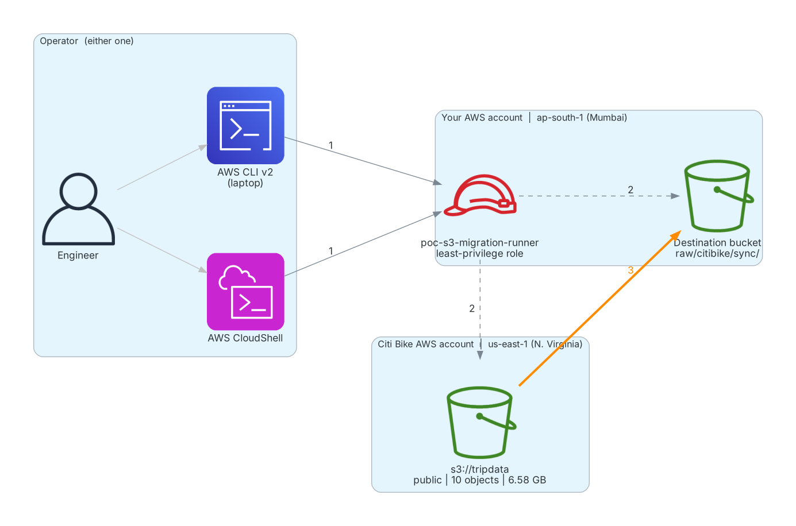
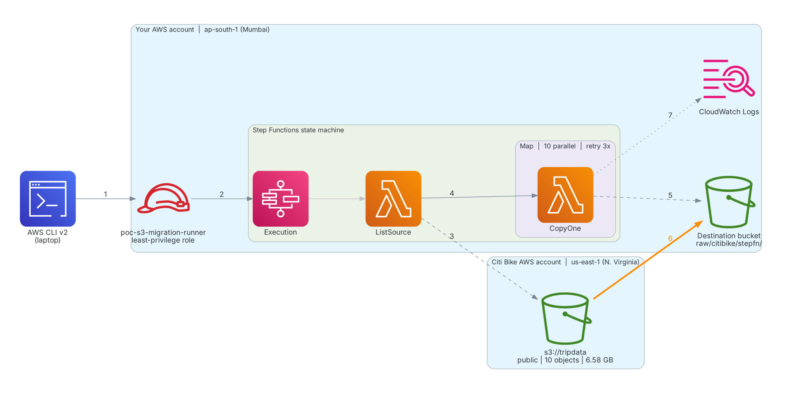
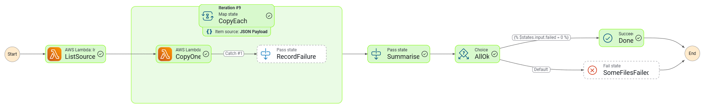
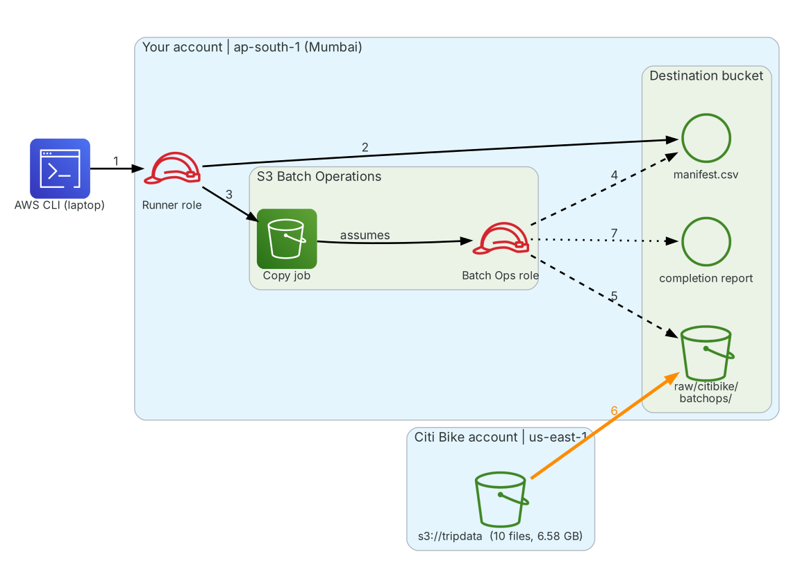
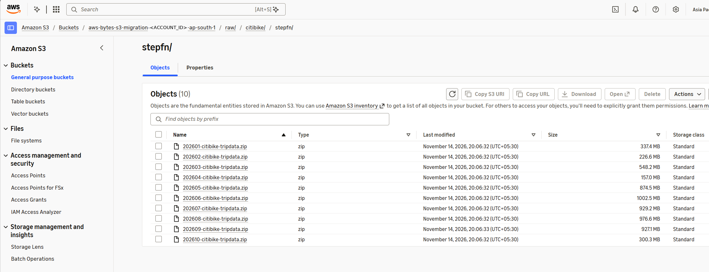

# How do you move data from someone else's S3 bucket into your S3 data lake — across AWS accounts and Regions?

A **one-time copy** of data you need for analytics or ML, from a bucket you **don't own**, into your **S3 data lake** in another Region. Several AWS services can do it. This PoC runs three of them end to end — as a least-privilege role, verified file by file.

**What I found:**
- The simplest option (one CLI command) failed first — the source lets you read files but **not their tags**.
- The **fastest** was a small Step Functions workflow — not the service built for bulk copies.
- **S3 Batch Operations** was the slowest here — and that's exactly the point of when (not) to use it.

## PoC scenario

| | |
|---|---|
| Source | `s3://tripdata` — Citi Bike public bucket, **another AWS account**, **us-east-1** |
| Destination | Our S3 data lake bucket in **ap-south-1 (Mumbai)**, created by [`infra/template.yaml`](infra/template.yaml) |
| Data | 2026 monthly zips `202601`–`202610` — **10 objects, 6.58 GB** |
| Goal | **One-time migration** (not continuous sync) — copy all 10 and prove nothing is missing |
| Runs from | **AWS CloudShell** or any terminal with **AWS CLI v2**, as a least-privilege IAM role |

## Possible options

| # | AWS service | Comments |
|---|---|---|
| 1 | AWS CLI `aws s3 sync` | Simplest — one command, no code. Good for one-off copies. ✅ Tested below |
| 2 | Step Functions (Map) + Lambda | Parallel copies with per-file status, retries and a size check. Good for repeatable pipelines. ✅ Tested below |
| 3 | S3 Batch Operations | No code, per-file completion report, built for millions of objects. Overkill for a handful. ✅ Tested below |
| 4 | AWS DataSync | Possible, not run here. Managed transfer service — no agent for S3 → S3, built-in verification, handles files over 5 GB. Cross-account **and** cross-Region together needs extra setup. Best for large or scheduled migrations; per-GB fee |
| 5 | S3 Replication (CRR) | Not possible here — replication is set up on the **source** bucket by its owner. If you own the source: built for ongoing copies of new objects (existing ones need S3 Batch Replication) |
| 6 | Amazon EMR (`s3-dist-cp`) | Possible, not run here. Runs a cluster to copy files in parallel — worth it at TB–PB scale, overkill for GBs |
| 7 | AWS Glue | Possible, not run here — a Glue job can copy files. But it's an ETL service: you'd pay job compute to move files that need no transforming |

---

## Setup (once)

**You need:** an AWS account · an **IAM user with admin rights** (the root user can't switch roles) · **AWS CLI v2** (already in CloudShell) · this repo cloned, with your terminal in this folder.

**1. Deploy the stack** with the admin IAM user (creates the bucket, roles, Lambdas, state machine):
```bash
aws cloudformation deploy --template-file infra/template.yaml --stack-name aws-bytes-s3-migration --capabilities CAPABILITY_NAMED_IAM --region ap-south-1
```

**2. Switch into the runner role** for everything below:
- **CloudShell:** open the stack's `SwitchRoleUrl` output, switch the console Region to **Asia Pacific (Mumbai)**, then open CloudShell. Drop `--profile runner` from the commands — CloudShell already runs as the role.
- **Terminal:** add this profile to `~/.aws/config` and use `--profile runner`:
```ini
[profile runner]
role_arn = arn:aws:iam::<ACCOUNT_ID>:role/poc-s3-migration-runner
source_profile = default
region = ap-south-1
```

**3. Note the stack outputs** (run as the admin user — the runner role can't read CloudFormation):
```bash
aws cloudformation describe-stacks --stack-name aws-bytes-s3-migration --region ap-south-1 --query "Stacks[0].Outputs[].[OutputKey,OutputValue]" --output table
```
| Output | Used for |
|---|---|
| `BucketName` | `<BUCKET_NAME>` in every command below |
| `SwitchRoleUrl` | switching into the runner role in the console / CloudShell |
| `StateMachineArn` | approach 2 |
| `BatchOpsRoleArn` | approach 3 (already in the job settings file) |

`<ACCOUNT_ID>` = your 12-digit AWS account ID (`aws sts get-caller-identity --query Account --output text`).

---

## 1. AWS CLI `aws s3 sync`



**Flow:** 1 CLI assumes the runner role → 2 lists source and destination → 3 S3 copies the bytes Region to Region.

**Run:**
```bash
# 1. Preview — lists what would be copied, copies nothing (--dryrun)
aws s3 sync s3://tripdata/ s3://<BUCKET_NAME>/raw/citibike/sync/ --exclude "*" --include "2026*-citibike-tripdata.zip" --source-region us-east-1 --region ap-south-1 --copy-props none --dryrun --profile runner

# 2. Copy the 10 zips; --copy-props none skips tags (the source allows reading files, not their tags)
aws s3 sync s3://tripdata/ s3://<BUCKET_NAME>/raw/citibike/sync/ --exclude "*" --include "2026*-citibike-tripdata.zip" --source-region us-east-1 --region ap-south-1 --copy-props none --profile runner
```
**Output** (our run, trimmed):
```text
# step 1
(dryrun) copy: s3://tripdata/202601-citibike-tripdata.zip to s3://<BUCKET_NAME>/raw/citibike/sync/202601-citibike-tripdata.zip
... (8 more files)
(dryrun) copy: s3://tripdata/202610-citibike-tripdata.zip to s3://<BUCKET_NAME>/raw/citibike/sync/202610-citibike-tripdata.zip

# step 2
Completed 8.0 MiB/6.1 GiB (2.2 MiB/s) with 10 file(s) remaining
copy: s3://tripdata/202604-citibike-tripdata.zip to s3://<BUCKET_NAME>/raw/citibike/sync/202604-citibike-tripdata.zip
... (8 more files)
Completed 6.1 GiB/6.1 GiB (22.0 MiB/s) with 1 file(s) remaining
copy: s3://tripdata/202609-citibike-tripdata.zip to s3://<BUCKET_NAME>/raw/citibike/sync/202609-citibike-tripdata.zip
```
**Result:**
- ⏱️ **Time taken: 4 min 49 s**
- ➕ One command, nothing to build.
- ➖ The terminal must stay open; no per-file report beyond the screen output.
- ✔️ No 5 GB limit — the CLI splits big files into parts automatically.

**Next:** ✅ [Verify the migration](#verify-the-migration-any-approach) with `<PREFIX>` = `sync`.

---

## 2. Step Functions (Map) + Lambda



**Flow:** 1 CLI assumes the runner role → 2 starts one execution → 3 `ListSource` lists the source → 4 Map sends each file to `CopyOne` (10 in parallel, retry 3×) → 5 `CopyOne` asks S3 to copy and checks the size → 6 bytes move S3 → S3 → 7 one log line per file.

Code: [`list_files_lambda.py`](list_files_lambda.py) lists the files · [`copy_file_lambda.py`](copy_file_lambda.py) copies one file. Both are also inline in the template.

**Run:**
```bash
# 1. Start the workflow (get <StateMachineArn> from the stack outputs); prints the execution ARN
aws stepfunctions start-execution --state-machine-arn <StateMachineArn> --name run-1 --query executionArn --output text --profile runner

# 2. Check it — repeat until status is SUCCEEDED
aws stepfunctions describe-execution --execution-arn <ExecutionArn> --query "{status:status,start:startDate,stop:stopDate,output:output}" --profile runner
```
**Output** (our run, trimmed):
```text
# step 1
arn:aws:states:ap-south-1:<ACCOUNT_ID>:execution:aws-bytes-s3-migration-copy:run-1

# step 2
{
    "status": "SUCCEEDED",
    "start": "2026-11-14T20:06:29.432000+05:30",
    "stop": "2026-11-14T20:09:57.800000+05:30",
    "output": "{\"bytes_copied\":6584519507,\"failed\":0,\"files\":10,\"ok\":10,\"results\":[{\"key\":\"202601-citibike-tripdata.zip\",\"src_size\":353829139,\"dst_size\":353829139,\"ok\":true}, ... (8 more files, all ok) ..., {\"key\":\"202610-citibike-tripdata.zip\",\"src_size\":314905579,\"dst_size\":314905579,\"ok\":true}]}"
}
```
**In the console** (Step Functions → `aws-bytes-s3-migration-copy` → run-1) — every state green:



**Result:**
- ⏱️ **Time taken: 3 min 28 s** — fastest of the three (all 10 files copied at once).
- ➕ Per-file `ok` + size check, retries you control, nothing to keep running.
- ➖ Two small Lambdas and a state machine to maintain.
- ⚠️ `CopyObject` copies **up to 5 GB per file** — larger files need a multipart copy in the Lambda.

**Next:** ✅ [Verify the migration](#verify-the-migration-any-approach) with `<PREFIX>` = `stepfn`.

---

## 3. S3 Batch Operations



**Flow:** 1 CLI assumes the runner role → 2 uploads the manifest → 3 creates the job and hands it the Batch Ops role → 4 job reads the manifest → 5 one copy per row → 6 bytes move S3 → S3 → 7 job writes a completion report.

**Two input files:**
- [`s3_batch_ops_manifest.csv`](s3_batch_ops_manifest.csv) — **the manifest: the list of files to copy**, one `bucket,key` per line, no header (e.g. `tripdata,202601-citibike-tripdata.zip`).
- [`s3_batch_ops_create_job.json`](s3_batch_ops_create_job.json) — **the job settings**: copy where, which manifest (with its ETag), where to write the report, which role to use. Before running, replace every `<ACCOUNT_ID>` and the `<MANIFEST_ETAG>` placeholder.

A Batch Ops job is a **one-time run** — you create a new job per copy, so it isn't part of the CloudFormation stack.

**Run:**
```bash
# 0. (Optional) Rebuild the manifest from the source listing — only if you change the files to copy (PowerShell)
#    (aws s3api list-objects-v2 --bucket tripdata --prefix 2026 --region us-east-1 --query "Contents[?ends_with(Key,'-citibike-tripdata.zip')].Key" --output text) -split "\s+" | Where-Object { $_ } | ForEach-Object { "tripdata,$_" } | Out-File -Encoding ascii s3_batch_ops_manifest.csv

# 1. Upload the manifest
aws s3 cp s3_batch_ops_manifest.csv s3://<BUCKET_NAME>/ops/batchops/manifests/manifest.csv --profile runner

# 2. Get its ETag — paste it, and your account ID, into s3_batch_ops_create_job.json
aws s3api head-object --bucket <BUCKET_NAME> --key ops/batchops/manifests/manifest.csv --query ETag --output text --profile runner

# 3. Create the job — it starts on its own (must be created in the destination Region)
aws s3control create-job --region ap-south-1 --cli-input-json file://s3_batch_ops_create_job.json --profile runner

# 4. Check it — repeat until Status is Complete
aws s3control describe-job --account-id <ACCOUNT_ID> --job-id <JobId> --region ap-south-1 --query "Job.{Status:Status,Created:CreationTime,Ended:TerminationDate,Progress:ProgressSummary,Failures:FailureReasons}" --profile runner
```
**Output** (our run):
```text
# step 2
"bb7a4c37482d90946715c3b4f44d519c"

# step 3
{
    "JobId": "0921224b-cad6-4474-98f0-b07a6a4204a9"
}

# step 4
{
    "Status": "Complete",
    "Created": "2026-11-14T18:35:55.607000+00:00",
    "Ended": "2026-11-14T18:58:23.416000+00:00",
    "Progress": {
        "TotalNumberOfTasks": 10,
        "NumberOfTasksSucceeded": 10,
        "NumberOfTasksFailed": 0,
        "Timers": {
            "ElapsedTimeInActiveSeconds": 1310
        }
    },
    "Failures": []
}
```
**Completion report** — download it, then open the CSV in `job-<JobId>/results/`:
```bash
aws s3 cp s3://<BUCKET_NAME>/ops/batchops/reports/ ./batchops-report/ --recursive --profile runner
```
Our report — one row per file (columns: bucket, key, version, status, error code, HTTP status, message):
```text
tripdata,202606-citibike-tripdata.zip,,succeeded,200,,Successful
tripdata,202602-citibike-tripdata.zip,,succeeded,200,,Successful
... (7 more rows, all succeeded)
tripdata,202609-citibike-tripdata.zip,,succeeded,200,,Successful
```
**Result:**
- ⏱️ **Time taken: 22 min 28 s** — slowest here; in this run S3 copied one file at a time.
- ➕ No code, a per-file report, and it scales to millions of objects.
- ➖ You can't control parallelism or retries. "Complete" ≠ all copied — always read the report.
- ⚠️ Copy jobs handle files **up to 5 GB** each — larger files need a Batch Ops job that invokes a Lambda.

**Next:** ✅ [Verify the migration](#verify-the-migration-any-approach) with `<PREFIX>` = `batchops`.

---

## Verify the migration (any approach)

Run these after **any** approach to prove the copy is complete — nothing missing, no wrong sizes, no extras. Set `<PREFIX>` to `sync` (approach 1), `stepfn` (approach 2) or `batchops` (approach 3).

**Expected:** the source holds **10 files, 6,584,519,507 bytes** — check it yourself:
```bash
aws s3api list-objects-v2 --bucket tripdata --region us-east-1 --query "[length(Contents[?starts_with(Key,'2026')]), sum(Contents[?starts_with(Key,'2026')].Size)]" --profile runner
```

**Check 1 — count and total size:**
```bash
# Expect Total Objects: 10 and Total Size: 6584519507
aws s3 ls s3://<BUCKET_NAME>/raw/citibike/<PREFIX>/ --recursive --summarize --profile runner
```
Output (our run, `stepfn` prefix, trimmed):
```text
2026-11-14 20:06:32  353829139 raw/citibike/stepfn/202601-citibike-tripdata.zip
... (8 more files)
2026-11-14 20:06:32  314905579 raw/citibike/stepfn/202610-citibike-tripdata.zip

Total Objects: 10
   Total Size: 6584519507
```
The same 10 files in the S3 console (`stepfn/` prefix):



**Check 2 — file by file:** the same `sync` command, in report-only mode. It compares each file in the destination with the source and **prints only what it would fix** — then does nothing (`--dryrun`):
- `(dryrun) copy:` → that file is **missing**, or its **size differs** from the source (`--size-only`)
- `(dryrun) delete:` → an **extra** file the source doesn't have (`--delete`)
- **no output** → nothing to fix: every file is there, at the right size, with no extras ✅

```bash
aws s3 sync s3://tripdata/ s3://<BUCKET_NAME>/raw/citibike/<PREFIX>/ --exclude "*" --include "2026*-citibike-tripdata.zip" --source-region us-east-1 --region ap-south-1 --size-only --delete --dryrun --profile runner
```
Our run: **no output** for all three approaches — both checks passed.

## Clean up

Run with your admin user:
```bash
# 1. Empty the bucket (CloudFormation can't delete a bucket that has files)
aws s3 rm s3://<BUCKET_NAME> --recursive

# 2. Delete everything the stack created
aws cloudformation delete-stack --stack-name aws-bytes-s3-migration --region ap-south-1
```

## Private source bucket in another account?

**Commands stay the same — only permissions change.** Click for the bucket policy the source owner adds.

<details>
<summary>Show details</summary>

The source here is **public**, so our roles only needed permissions in **our** account. If the source bucket is **private**, its owner adds a bucket policy that lets your roles read:

```json
{
  "Version": "2012-10-17",
  "Statement": [{
    "Effect": "Allow",
    "Principal": { "AWS": [
      "arn:aws:iam::<YOUR_ACCOUNT_ID>:role/poc-s3-migration-runner",
      "arn:aws:iam::<YOUR_ACCOUNT_ID>:role/poc-s3-migration-list-files-lambda",
      "arn:aws:iam::<YOUR_ACCOUNT_ID>:role/poc-s3-migration-copy-file-lambda",
      "arn:aws:iam::<YOUR_ACCOUNT_ID>:role/poc-s3-migration-batchops"
    ]},
    "Action": ["s3:ListBucket", "s3:GetObject"],
    "Resource": ["arn:aws:s3:::<SOURCE_BUCKET>", "arn:aws:s3:::<SOURCE_BUCKET>/*"]
  }]
}
```
If the source objects are encrypted with **SSE-KMS**, the source owner must also allow your roles `kms:Decrypt` on that key.

</details>